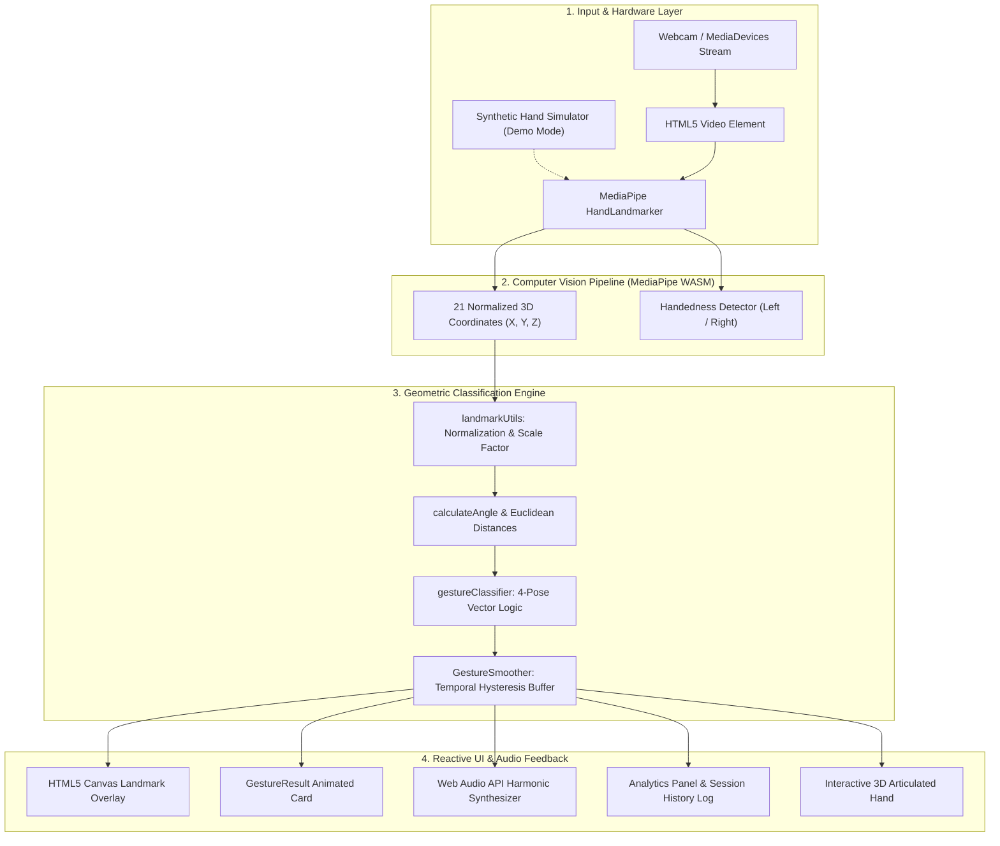

# GESTURE AI
### *"Your Hands. Your Commands. Powered by AI."*

[](https://vitejs.dev/)
[](https://react.dev/)
[](https://developers.google.com/mediapipe)
[](https://threejs.org/)
[](https://tailwindcss.com/)
[](LICENSE)

A commercial-grade, real-time AI Hand Gesture Recognition web application built on **Google MediaPipe Tasks Vision**, **React 18**, **Three.js / React Three Fiber**, and **Tailwind CSS**. GESTURE AI runs entirely client-side inside the browser using WebAssembly and WebGL—zero server latency, zero cloud costs, and 100% privacy preservation.

---

## Table of Contents
1. [Project Title & Branding](#1-project-title--branding)
2. [Project Overview](#2-project-overview)
3. [Problem Statement](#3-problem-statement)
4. [Objectives](#4-objectives)
5. [Key Features](#5-key-features)
6. [Technology Stack](#6-technology-stack)
7. [System Architecture](#7-system-architecture)
8. [AI Recognition Workflow](#8-ai-recognition-workflow)
9. [Explanation of the Four Gestures](#9-explanation-of-the-four-gestures)
10. [Installation Instructions](#10-installation-instructions)
11. [How to Run the Project](#11-how-to-run-the-project)
12. [Camera Permission Instructions](#12-camera-permission-instructions)
13. [Screenshots Section](#13-screenshots-section)
14. [Demo Video Section](#14-demo-video-section)
15. [Limitations](#15-limitations)
16. [Future Improvements](#16-future-improvements)
17. [Contributors & License](#17-contributors--license)
18. [GitHub Upload Instructions](#18-github-upload-instructions)

---

## 1. Project Title & Branding
- **Name**: **GESTURE AI**
- **Tagline**: *"Your Hands. Your Commands. Powered by AI."*
- **Visual Identity**: Premium Futuristic **Blue and White 3D Theme**
  - Primary Blue: `#1677FF`
  - Electric Blue: `#258BFF`
  - Navy: `#092B59`
  - Light Blue: `#EAF4FF`
  - Background: `#F7FAFF`
  - Pure White: `#FFFFFF`
  - Cyan Accent: `#55D6FF`

---

## 2. Project Overview
GESTURE AI is an interactive, browser-native Human-Computer Interaction (HCI) platform. By leveraging Google's MediaPipe Hand Landmarker neural network alongside deterministic kinematic classification algorithms, the application tracks 21 spatial hand landmark joints at 60 FPS directly through an ordinary consumer webcam.

The application translates spatial finger geometry into deterministic digital commands with sub-15ms inference latency, accompanied by real-time landmark canvas visualizations, responsive 3D articulated robotic kinematics, harmonic audio synthesized feedback, and live analytics telemetry.

---

## 3. Problem Statement
Traditional digital interfaces rely heavily on physical contact with hardware peripherals (mice, keyboards, touchscreens). In numerous scenarios—such as sterile healthcare settings, industrial manufacturing, interactive public kiosks, presentations, and assistive accessibility for individuals with physical speech or motor barriers—touch-based interactions present hygienic risks, ergonomic friction, or accessibility hurdles.

Existing computer vision solutions often suffer from:
1. **Cloud Latency & High Costs**: Sending continuous video streams to remote cloud APIs introduces significant latency (200ms–800ms) and prohibitive recurring costs.
2. **Privacy Vulnerabilities**: Users are uncomfortable uploading live personal camera footage to cloud servers.
3. **Fragile Gesture Switching**: Raw neural net outputs frequently flicker between classes when a hand undergoes minor natural tremor.

---

## 4. Objectives
- **Zero Cloud Reliance**: Execute all computer vision, landmark extraction, and gesture classification 100% locally on user hardware via WebAssembly.
- **Strict Geometric Classification**: Implement mathematically grounded, scale-invariant algorithms to recognize four core gestures:
  1. *Open Hand*
  2. *Fist*
  3. *Thumbs Up*
  4. *Victory / Peace*
- **Temporal Stability**: Eliminate false flickers using a sliding-window hysteresis smoother.
- **Immersive 3D Experience**: Present an articulated 3D cybernetic hand built with Three.js / React Three Fiber that mirrors and demonstrates each gesture.
- **Enterprise-Grade UI/UX**: Provide a glassmorphic blue-and-white visual identity, dark/light mode toggle, audio chime synthesis via Web Audio API, real-time analytics, and session history export.

---

## 5. Key Features

### 🎮 Real-Time Webcam Detection Dashboard
- Direct WebRTC camera access with resolution up to 1280x720.
- Automatic camera enumeration with multi-camera switching support.
- Natural mirror mode toggle with synchronized landmark alignment.
- Live landmark HUD with bounding box and confidence tags.

### 🧠 21-Landmark Kinetic Canvas Visualization
- Real-time HTML5 Canvas hardware-accelerated overlay.
- Dual-layer bone drawing: outer cyan ambient glow with electric blue inner lines.
- Pulsing concentric wrist anchor (Landmark 0) and high-visibility cyan fingertip nodes.
- Responsive scaling adjusting to webcam client boundaries.

### 📐 Deterministic Kinematic Classifier
- Scale-invariant coordinate normalization using wrist-to-middle-MCP reference distance ($D_{\text{ref}}$).
- Joint flexion angles calculated via vector dot products ($\angle \text{MCP-PIP-TIP}$).
- Spatial orientation tracking for Thumbs Up in screen/camera coordinate systems.
- Calibrated confidence scoring reflecting geometric distance margins.

### 🌊 Temporal Smoothing & Hysteresis
- 6-frame rolling window buffer requiring $\ge 67\%$ consensus to confirm transitions.
- Grace-period drop tolerance preventing abrupt state clearing from single-frame camera occlusions.

### 🤖 Interactive 3D Cybernetic Hand
- Articulated procedural 3D hand model with 21 glowing landmark spheres and energy bones.
- Mouse parallax tracking with organic breathing and floating idle animations.
- Real-time pose switching allowing users to preview all 4 gestures in 3D.

### 📊 Real-Time Analytics & Recognition Timeline
- Live hardware metrics: FPS counter, latency in milliseconds, active hand count.
- Confirmed gesture distribution breakdown with session percentage shares.
- Active session stopwatch timer.
- Recognition history feed with timestamps, confidence scores, and one-click JSON export.

### 🧪 Synthetic Hand Simulator (Demo Mode)
- Built-in mathematical hand trajectory generator cycling through all 4 gestures.
- Allows full functional evaluation in sandboxed environments or devices without webcam hardware.

---

## 6. Technology Stack

| Layer | Technology | Purpose |
|---|---|---|
| **Frontend Framework** | React 18.3.1 | Component-based reactive UI architecture |
| **Bundler & Dev Server** | Vite 5.4.10 | Instant Hot Module Replacement & production bundling |
| **AI / Computer Vision** | MediaPipe Tasks Vision 0.10.17 | WebAssembly hand landmark detection model |
| **3D Graphics** | Three.js R169 & React Three Fiber 8.17 | Articulated 3D hand scene and WebGL rendering |
| **3D Helpers** | React Three Drei 9.114 | Float physics, Sparkles particles, and OrbitControls |
| **Styling & Theme** | Tailwind CSS 3.4.14 | Blue & White futuristic glassmorphic design system |
| **Motion & Microinteractions** | Framer Motion 11.11 | Gesture transitions, fade animations, and cards |
| **Icons** | Lucide React | High-tech icon library |
| **Audio Synthesis** | Native Web Audio API | Client-side harmonic chime generation |
| **Routing** | React Router DOM 6.27 | Client-side page navigation |

---

## 7. System Architecture



---

## 8. AI Recognition Workflow

1. **Frame Capture**: Video frame rendered to hidden video element at 60 Hz.
2. **Inference**: `handLandmarker.detectForVideo(video, timestamp)` processes the frame via GPU/WebGL delegate.
3. **Scale Normalization**:
   $$\text{HandScale} = \sqrt{(x_{\text{mcp9}} - x_{\text{wrist}})^2 + (y_{\text{mcp9}} - y_{\text{wrist}})^2}$$
4. **Joint Extension Evaluation**:
   $$\theta_{\text{PIP}} = \arccos\left(\frac{\vec{v}_{\text{MCP}\to\text{PIP}} \cdot \vec{v}_{\text{TIP}\to\text{PIP}}}{\|\vec{v}_{\text{MCP}\to\text{PIP}}\| \|\vec{v}_{\text{TIP}\to\text{PIP}}\|}\right)$$
5. **Pose Classification**: Matches criteria against Open Hand, Fist, Thumbs Up, and Victory profiles.
6. **Temporal Filtering**: Validates consistency across sliding window buffer before updating confirmed state.
7. **Audio & UI Dispatch**: Triggers harmonic dual-tone chime and appends confirmed gesture to session history.

---

## 9. Explanation of the Four Gestures

### 🖐️ Gesture 1: Open Hand
- **Anatomical Criteria**:
  - Thumb: Extended outward (separation $> 0.65 \times \text{HandScale}$).
  - Index, Middle, Ring, Pinky: All 4 fingers fully extended.
  - Joint Angle: $\angle \text{PIP} > 135^\circ$ for all digits.
  - Tip-to-Wrist Ratio: $\frac{D(\text{Wrist}, \text{Tip})}{D(\text{Wrist}, \text{PIP})} > 1.20$.
- **Interaction Uses**: Navigation reset, pause stream, wave commands, open menu.

### ✊ Gesture 2: Fist
- **Anatomical Criteria**:
  - Fingers 1–4: Folded tightly into the palm.
  - Fingertips positioned adjacent to metacarpophalangeal (MCP) joints.
  - Joint Angle: Acute flexion ($\angle \text{PIP} < 115^\circ$).
  - Tip-to-Wrist Ratio: $\le 1.05$.
- **Interaction Uses**: Grab objects, drag element, confirm selection, trigger click.

### 👍 Gesture 3: Thumbs Up
- **Anatomical Criteria**:
  - Thumb: Extended upward with Tip $Y < \text{IP } Y < \text{MCP } Y < \text{Wrist } Y$ (in inverted screen coordinates).
  - Vertical Vector Alignment: Upward alignment score $> 0.40$.
  - Fingers 1–4: Index, Middle, Ring, and Pinky must all be tightly folded into palm.
- **Interaction Uses**: Confirm, like, approve action, advance to next item.

### ✌️ Gesture 4: Victory / Peace
- **Anatomical Criteria**:
  - Index & Middle: Both extended with $\angle \text{PIP} > 135^\circ$.
  - Separation: Euclidean distance between Index Tip and Middle Tip $> 0.25 \times \text{HandScale}$.
  - Ring & Pinky: Curled tightly into palm.
  - Thumb: Folded across palm or tucked over ring finger.
- **Interaction Uses**: Select mode B, peace gesture, trigger camera countdown.

---

## 10. Installation Instructions

### Prerequisites
- [Node.js](https://nodejs.org/) v18.0.0 or higher
- [npm](https://www.npmjs.com/) v9.0.0 or higher
- A modern web browser with WebGL and WebRTC support (Google Chrome, Microsoft Edge, Brave, Mozilla Firefox, or Safari)

### Step-by-Step Installation
1. Clone the repository:
   ```bash
   git clone https://github.com/your-username/gesture-ai.git
   cd gesture-ai
   ```
2. Install npm dependencies:
   ```bash
   npm install
   ```

---

## 11. How to Run the Project

### Development Server
Start the local Vite development server:
```bash
npm run dev
```
Open your browser and navigate to:
```
http://localhost:5174
```

### Production Build
To create an optimized production build:
```bash
npm run build
```
To preview the production build locally:
```bash
npm run preview
```

---

## 12. Camera Permission Instructions

When you launch the Live AI Detection Dashboard for the first time:

1. **Browser Permission Prompt**:
   - Your browser will display a permission prompt: *"Allow GESTURE AI to use your camera?"*
   - Click **"Allow"**.
2. **If You Accidentally Clicked "Block"**:
   - **Google Chrome / Microsoft Edge**:
     - Click the lock/settings icon in the left of the URL address bar.
     - Toggle **Camera** to **Allow**.
     - Refresh the page ($F5$ or $Cmd+R$).
   - **Apple Safari**:
     - Go to Safari > Settings > Websites > Camera.
     - Set `localhost` to **Allow**.
3. **If No Camera is Available**:
   - Click **"Try Demo Simulator"** in the dashboard. The application will immediately generate a synthetic 21-landmark hand trajectory cycling through all 4 gestures for full testing.

---

## 13. Screenshots Section

*(Add your application screenshots here after hosting or running)*

- **Hero Landing Page with 3D Cybernetic Hand**: Demonstrating articulated kinematics and blue-white visual styling.
- **Live AI Detection Dashboard**: Showing webcam feed with dual-layer landmark skeleton and real-time bounding box.
- **Kinematic Telemetry & Gesture Result Card**: Displaying live confidence bar, finger states telemetry, and latency.
- **Gesture Library Page**: Showing interactive 3D model pose morphing and mathematical rule specifications.

---

## 14. Demo Video Section

*(Record a short 30-to-60-second screen capture demonstrating real-time camera tracking and paste link here)*

- Video Demonstration: `https://youtu.be/your-demo-video-id`

---

## 15. Limitations
- **Extreme Hand Rotations**: Classification accuracy decreases when the hand is turned edge-on (lateral view) where fingers occlude one another.
- **Severe Low-Light Conditions**: In extreme darkness or heavy motion blur, landmark detection confidence from MediaPipe decreases.
- **Multiple Overlapping Hands**: While the pipeline supports tracking up to 2 hands simultaneously, gesture classification currently focuses on the primary dominant hand in frame.

---

## 16. Future Improvements
- [ ] Add Custom Dynamic Gesture Recording (allowing users to record and train custom poses via Few-Shot KNN).
- [ ] Integrate Swipe and Pinch velocity tracking for touchless slide decks.
- [ ] Implement Two-Handed Compound Gestures (e.g., Zoom In / Zoom Out).
- [ ] WebXR / Three.js Virtual Reality avatar hand puppeteering.

---

## 17. Contributors & License

### Contributors
- **GESTURE AI Development Team**
- Built for Computer Vision & Full-Stack AI Pair Programming Showcase.

### License
This project is open-source and licensed under the **MIT License**.

---

## 18. GitHub Upload Instructions

Run the following commands in your terminal to initialize and upload this project to your GitHub repository:

```bash
# 1. Check git status
git status

# 2. Stage all project files
git add .

# 3. Create a descriptive commit
git commit -m "feat: complete GESTURE AI production web application with MediaPipe tracking, Three.js 3D hand, and real-time dashboard"

# 4. Link your remote repository (replace with your repository URL)
git remote add origin https://github.com/your-username/gesture-ai.git

# 5. Push to GitHub main branch
git branch -M main
git push -u origin main
```
